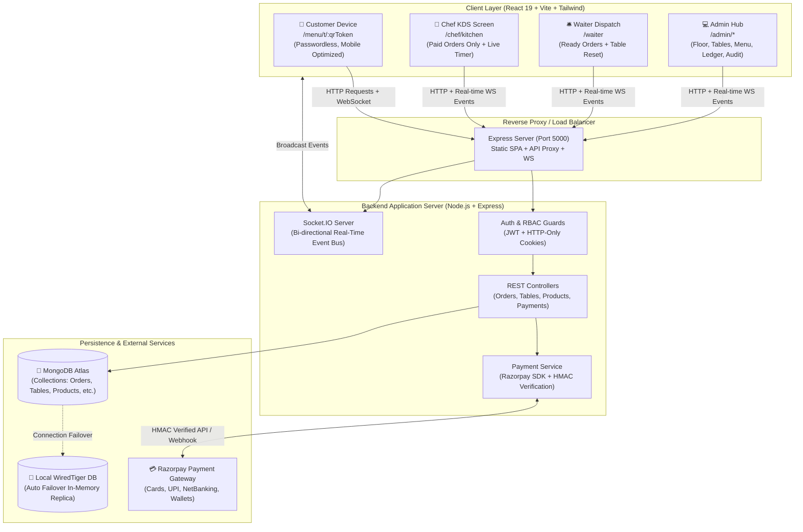
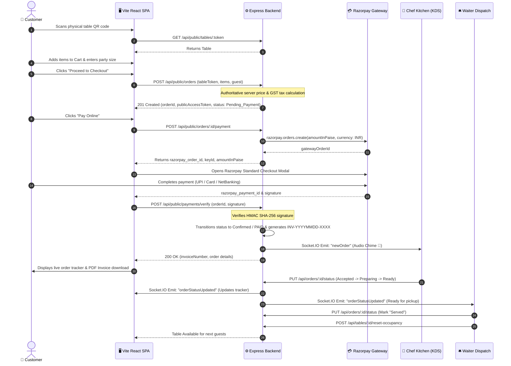
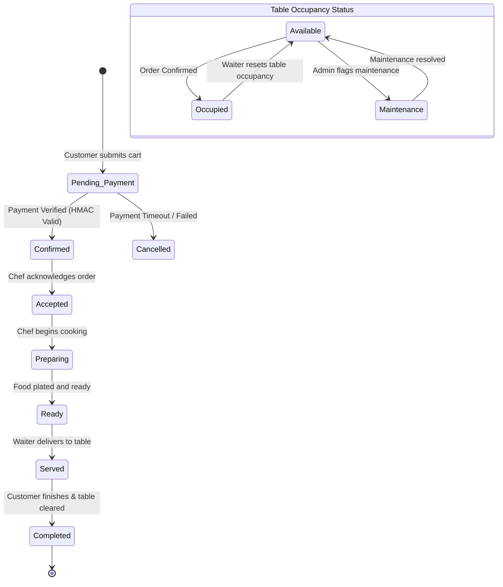
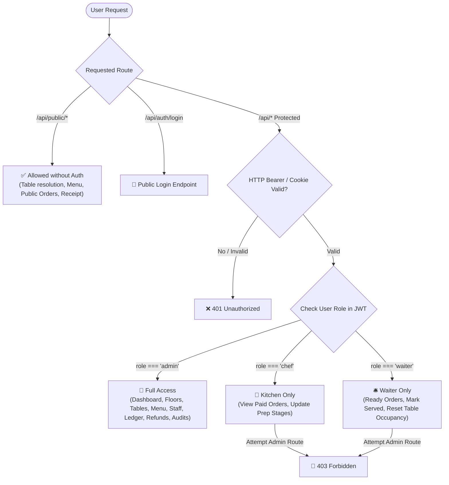

# DineSync — Restaurant Management, QR Ordering, Payments & Billing Platform


**DineSync** is an enterprise-grade restaurant management and customer ordering platform. It provides frictionless passwordless table QR-code ordering, real-time Kitchen Display System (KDS), waiter dispatch notifications, authoritative Razorpay payment processing in integer paise, automated sequential GST tax invoices with PDF generation, floor/table occupancy management, and a comprehensive administrative control panel with immutable audit logging.

---

## 📑 Table of Contents
1. [Visual System Flows](#1-visual-system-flows)
   - [A. System Architecture & Topology](#a-system-architecture--topology)
   - [B. End-to-End Order & Payment Sequence Flow](#b-end-to-end-order--payment-sequence-flow)
   - [C. Order & Table State Machine](#c-order--table-state-machine)
   - [D. Role-Based Access Control (RBAC) Flow](#d-role-based-access-control-rbac-flow)
2. [Complete Technology Stack](#2-complete-technology-stack)
3. [Project Directory Structure](#3-project-directory-structure)
4. [Quickstart & Local Setup](#4-quickstart--local-setup)
5. [Default Demo Credentials](#5-default-demo-credentials)
6. [Core Features & Functional Modules](#6-core-features--functional-modules)
7. [Financial Precision & Security Architecture](#7-financial-precision--security-architecture)
8. [REST API Reference](#8-rest-api-reference)
9. [Automated Testing Suite (19/19 Passing)](#9-automated-testing-suite-1919-passing)
10. [Production Deployment Guide](#10-production-deployment-guide)
    - [Option 1: Docker & Docker Compose (Containerized)](#option-1-docker--docker-compose-containerized)
    - [Option 2: Cloud PaaS (Render / Railway / Fly.io / Heroku)](#option-2-cloud-paas-render--railway--flyio--heroku)
    - [Option 3: Unified Node.js Host](#option-3-unified-nodejs-host)
11. [Step-by-Step GitHub Push Guide](#11-step-by-step-github-push-guide)
12. [Troubleshooting Guide](#12-troubleshooting-guide)
13. [License](#13-license)

---

## 1. Visual System Flows

### A. System Architecture & Topology



---

### B. End-to-End Order & Payment Sequence Flow



---

### C. Order & Table State Machine



---

### D. Role-Based Access Control (RBAC) Flow



---

## 2. Complete Technology Stack

| Layer | Technology | Version | Purpose & Description |
| :--- | :--- | :--- | :--- |
| **Frontend Framework** | **React** | `^19.2.8` | Next-generation React library with modern Hooks, Context API, and Concurrent Rendering |
| **Frontend Build Tool** | **Vite** | `^8.2.0` | Ultra-fast ESM bundler with instant HMR and optimized Rollup production builds |
| **Styling & UI** | **Tailwind CSS** | `^4.3.3` | Modern utility-first CSS framework with dynamic responsive layouts |
| **Iconography** | **Lucide React** | `^1.31.0` | Modern, consistent icon library for dashboards, kitchen indicators, and mobile views |
| **Charts & Analytics** | **Recharts** | `^3.10.1` | Declarative SVG charting library for admin revenue, order volume, and table occupancy stats |
| **PDF Generation** | **jsPDF** & **html2canvas** | `^4.2.1` | Client-side generation and rendering of official GST tax invoices for download |
| **QR Code Engine** | **qrcode.react** | `^4.2.0` | High-definition SVG/Canvas rendering of printable table QR codes |
| **Visual Effects** | **canvas-confetti** | `^1.9.4` | Delighting micro-animations upon successful checkout and payment confirmation |
| **Backend Runtime** | **Node.js** | `>= 18.x` | High-performance asynchronous JavaScript engine |
| **Web Server** | **Express.js** | `^4.19.2` | Robust RESTful routing engine, raw body stream verification, and security middleware |
| **Real-time Engine** | **Socket.IO** | `^4.8.3` | Full-duplex WebSocket communication between customer, kitchen, waiter, and admin |
| **Database ODM** | **Mongoose** | `^8.3.0` | Strict schema validation, relations, and business logic for MongoDB |
| **Cloud Database** | **MongoDB Atlas** | `v7.0+` | Scalable cloud document database for persistent production storage |
| **Embedded DB Fallback**| **mongodb-memory-server** | `^11.3.0` | Local WiredTiger fallback ensuring zero setup friction if cloud Atlas connection times out |
| **Payment Gateway** | **Razorpay Node SDK** | `^2.9.8` | Official payment gateway integration for INR UPI, credit/debit cards, and netbanking |
| **Security & Crypto** | **Crypto (Native)** | Built-in | HMAC-SHA256 signature calculation and verification for payments and webhooks |
| **Authentication** | **jsonwebtoken** | `^9.0.2` | Cryptographically signed access tokens for Role-Based Access Control |
| **Password Hashing** | **bcryptjs** | `^2.4.3` | One-way salt hashing (10 rounds) for secure staff credential storage |
| **HTTP Client** | **Axios** | `^1.19.0` | Promise-based HTTP client with request/response interceptors and bearer injection |
| **Testing Engine** | **Node.js Test Runner** | `node:test` | Native subtest execution and assertions (`node:assert`) |
| **Containerization** | **Docker & Compose** | Multi-stage | Alpine-based multi-stage containerization with zero runtime devDependencies |

---

## 3. Project Directory Structure

```
hotel/
├── Dockerfile                 # Multi-stage production Docker container
├── docker-compose.yml         # Container stack (MongoDB + DineSync unified app)
├── render.yaml                # 1-click cloud PaaS blueprint definition
├── package.json               # Root scripts (postinstall, build, start, test, seed)
├── .env.example               # Root environment variable template
├── .gitignore                 # Excludes secrets, node_modules, builds, and local databases
├── client/                    # Frontend React 19 SPA
│   ├── src/
│   │   ├── components/        # Reusable components (TableQRCode, StatusBadge, Sidebar)
│   │   ├── context/           # CartContext, AuthContext (JWT & state management)
│   │   ├── pages/             # CustomerDashboard, Cart, OrderStatus, Admin, Chef, Waiter
│   │   ├── services/          # Axios api.js, Socket.IO socket.js
│   │   ├── App.jsx            # Dynamic role-protected routing
│   │   └── main.jsx           # React root mounting
│   ├── vite.config.js         # Vite configuration with dev /api proxy
│   └── package.json           # Client dependencies & build scripts
└── server/                    # Backend Node.js + Express API
    ├── config/db.js           # Resilient DB connector (Atlas + local fallback)
    ├── controllers/           # auth, order, payment, floor, table, product, user, settings
    ├── middleware/            # authMiddleware, adminMiddleware (adminOnly, chefOnly, waiterOnly)
    ├── models/                # Floor, Table, Product, Category, Order, PaymentTransaction, AuditLog
    ├── routes/                # REST endpoints and Webhook receiver
    ├── scripts/               # bootstrap-admin.js (secure one-off admin provisioner)
    ├── services/              # paymentService.js (Razorpay paise, HMAC verification, invoices)
    ├── test/                  # dinesync.test.js (Automated integration suite)
    ├── server.js              # Express app, static SPA host & Socket.IO server
    └── seed.js                # Database seeder (floors, tables, menu, staff)
```

---

## 4. Quickstart & Local Setup

### Step 1: Clone and Install Dependencies
From the repository root:
```bash
# Clone the repository
git clone <your-repository-url>
cd hotel

# Single command to install root, server, and client dependencies:
npm run install:all
```

### Step 2: Environment Configuration
Copy the template to `server/.env`:
```bash
cp .env.example server/.env
```
*(On Windows PowerShell: `Copy-Item .env.example server\.env`)*

The default `.env` is pre-configured for instant local development. If MongoDB Atlas is unreachable or IP is unwhitelisted, the server seamlessly boots a local persistent WiredTiger database.

### Step 3: Seed Database
```bash
npm run seed
```
This populates floors (Ground Floor, First Floor, Rooftop), tables with unique QR tokens, 20+ categorized menu items, and staff accounts.

### Step 4: Run Development Servers
In two separate terminals:
```bash
# Terminal 1: Run Backend API & WebSocket Server (Port 5000)
npm run dev:server

# Terminal 2: Run Frontend Vite Development Server (Port 3000)
npm run dev:client
```
Open **http://localhost:3000** in your browser.

---

## 5. Default Demo Credentials

| Role | Email | Password | Access Route | Functional Scope |
| :--- | :--- | :--- | :--- | :--- |
| **Admin** | `admin@cafe.com` | `admin123` | `/admin/login` | Full control: Analytics, Floors, Tables, Menu, Staff, Billing, Audit Logs |
| **Chef** | `chef@cafe.com` | `chef123` | `/chef/login` | Kitchen Display System (KDS): Paid orders queue, cooking stages, timers |
| **Waiter** | `waiter@cafe.com` | `waiter123` | `/waiter/login` | Service Dispatch: Ready orders notification, mark served, reset table occupancy |
| **Customer** | *(None)* | *(Passwordless)* | `/menu/t/:qrToken` | Table menu browsing, guest count, cart, Razorpay payment, live tracker & PDF invoice |

---

## 6. Core Features & Functional Modules

### 1. Customer Ordering & QR Code Isolation
- **Cryptographic QR Tokens:** Each physical table has a unique, unguessable 32-character token (`/menu/t/:qrToken`).
- **Capacity Validation:** Customer party size cannot exceed table seat capacity.
- **Cart & Server-Side Pricing:** Taxes, item totals, and grand totals are authoritatively computed on the server in integer paise.
- **Live Order Tracker:** Progress indicators (`Confirmed` → `Accepted` → `Preparing` → `Ready` → `Served`).
- **Official Tax Invoice:** Sequential GST tax invoice (`INV-YYYYMMDD-XXXX`) available for instant PDF download via `jsPDF`.

### 2. Kitchen Display System (KDS)
- **Paid Orders Only:** Only orders with confirmed payment (`PAID` / `Confirmed`) appear in the kitchen queue.
- **Stage Progression:** Chef advances tickets: `Accepted` → `Preparing` → `Ready`.
- **Elapsed Timers:** Visual urgency indicators (Green < 10m, Amber 10-15m, Red > 15m).
- **Sound Alerts:** Audio chime plays immediately upon incoming paid orders via Socket.IO.

### 3. Waiter Dispatch & Floor Management
- **Service Notification:** Instant alert when dishes are marked `Ready` by the kitchen.
- **Mark as Served:** Records actual fulfillment time.
- **Table Occupancy Reset:** One-click table clearance resets status from `Occupied` to `Available`.

### 4. Administrative Control Center
- **Floor Management:** Create, reorder, and configure floors (Ground Floor, First Floor, Rooftop).
- **Table Management & QR Code Generator:** Configure seat capacity, table names, and generate high-resolution printable QR code cards with one-click token revocation.
- **Menu Management:** Categorized catalog with pricing, vegetarian/vegan/special badges, and stock toggling.
- **Transaction Ledger & Refunds:** Full transaction ledger with one-click refund initiation.
- **Immutable Audit Trail:** Chronological record of administrative operations (pricing modifications, refunds, token revocations).

---

## 7. Financial Precision & Security Architecture

1. **Integer Paise Financial Precision:**
   All transactions calculate and store monetary values in integer paise (e.g., `₹250.00` = `25000 paise`) alongside standard INR. This eliminates floating-point rounding inaccuracies.
2. **HMAC SHA-256 Payment Verification:**
   ```javascript
   const expectedSignature = crypto
     .createHmac('sha256', process.env.RAZORPAY_KEY_SECRET)
     .update(`${razorpay_order_id}|${razorpay_payment_id}`)
     .digest('hex');
   ```
3. **Idempotent Webhook Handling:**
   Incoming Razorpay webhooks (`POST /api/webhooks/razorpay`) verify the `x-razorpay-signature` against the raw request buffer. Idempotent logic prevents duplicate ticket creation or duplicate tax invoices.
4. **Role-Based Access Control (RBAC):**
   Staff routes are guarded with JWT authentication stored in HTTP-Only, SameSite cookies and verified via Express middleware (`adminOnly`, `chefOnly`, `waiterOnly`).

---

## 8. REST API Reference

### Public Customer Endpoints (Passwordless)
| Method | Endpoint | Description |
| :--- | :--- | :--- |
| `GET` | `/api/public/tables/:token` | Resolves table details, capacity, and floor from QR token |
| `GET` | `/api/public/menu` | Retrieves active menu items grouped by categories |
| `POST` | `/api/public/orders` | Creates passwordless order with server price validation |
| `GET` | `/api/public/orders/:publicAccessToken` | Retrieves order tracking status by unguessable token |
| `POST` | `/api/public/orders/:id/payment` | Creates official Razorpay order in integer paise |
| `POST` | `/api/public/payments/verify` | Authoritatively verifies payment signature & confirms order |
| `GET` | `/api/public/orders/:publicAccessToken/receipt` | Retrieves tax receipt data for client-side PDF rendering |

### Protected Staff & Admin Endpoints
| Method | Endpoint | Description | Guard |
| :--- | :--- | :--- | :--- |
| `POST` | `/api/auth/login` | Issues authenticated JWT in HTTP-Only cookie | Public |
| `POST` | `/api/auth/logout` | Clears authentication session cookies | Protected |
| `GET` | `/api/admin/dashboard` | Aggregated sales, revenue, order, and table metrics | `adminOnly` |
| `GET/POST`| `/api/floors` | List and create restaurant floors | `adminOnly` |
| `GET/POST`| `/api/tables` | List and create restaurant tables | `adminOnly` |
| `POST` | `/api/tables/:id/qr/regenerate`| Revokes existing QR token and generates new token | `adminOnly` |
| `GET/POST`| `/api/products` | Manage menu items, pricing, and availability | `adminOnly` |
| `GET` | `/api/orders?paidOnly=true`| Fetch active paid kitchen orders | `chef` / `admin` |
| `PUT` | `/api/orders/:id/status` | Advance kitchen state (`Preparing`, `Ready`, `Served`) | Staff |
| `POST` | `/api/tables/:id/reset-occupancy`| Reset occupied table back to available | Staff |
| `GET` | `/api/admin/payments` | View full transaction ledger and status | `adminOnly` |
| `POST` | `/api/admin/payments/:id/refund`| Process full or partial payment refund | `adminOnly` |
| `GET` | `/api/audit-logs` | Retrieve chronological administrative audit logs | `adminOnly` |
| `POST` | `/api/webhooks/razorpay` | Validates HMAC signature and reconciles payments | Webhook HMAC |

---

## 9. Automated Testing Suite (19/19 Passing)

DineSync includes an automated integration test suite written with the native Node.js test runner (`node:test` & `node:assert`).

Run the test suite anytime:
```bash
npm test
```

### Verified Test Assertions:
```text
▶ DineSync Comprehensive Platform Automated Test Suite
  ✔ 1. Health check endpoint responds OK
  ✔ 2. Public table QR resolution by token
  ✔ 3. Public menu returns active products and categories
  ✔ 4. Passwordless customer order creation with server price calculation
  ✔ 5. Rejection of order exceeding table capacity
  ✔ 6. Order tracking by unguessable public access token
  ✔ 7. Payment gateway order creation in paise
  ✔ 8. Authoritative payment verification, invoice generation, and kitchen confirmation
  ✔ 9. Paid tax invoice / receipt retrieval
  ✔ 10. Staff authentication & authorized kitchen state transitions
  ✔ 11. QR token revocation and regeneration
  ✔ 12. Rejection of advancing kitchen status on unpaid order
  ✔ 13. Protection against modifying completed terminal orders
  ✔ 14. Webhook security: rejection of invalid HMAC signatures
  ✔ 15. Webhook security: authoritative signature validation & idempotent processing
  ✔ 16. Waiter dashboard: reset table occupancy when customer completed their dine
  ✔ 17. Resilient table resolution: handles tableNumber, prefixes, and stale token fallback
  ✔ 18. QR Code Scanning & Isolation: Scanning Table 1 correctly resolves Table 1 and prevents cross-table hijack
✔ DineSync Comprehensive Platform Automated Test Suite
ℹ tests 19 | suites 0 | pass 19 | fail 0 | cancelled 0 | skipped 0 | todo 0
```

---

## 10. Production Deployment Guide

### Option 1: Docker & Docker Compose (Containerized)
The repository includes a production multi-stage `Dockerfile` and `docker-compose.yml`.

Run the complete stack (MongoDB + DineSync unified server):
```bash
# Build and start containers in the background
docker compose up --build -d

# View logs
docker compose logs -f app
```
Access the application at **http://localhost:5000**.

---

### Option 2: Cloud PaaS (Render / Railway / Fly.io / Heroku)

#### Deploy to Render via Blueprint (`render.yaml`):
1. Push your repository to GitHub.
2. In the [Render Dashboard](https://dashboard.render.com), click **New +** → **Blueprint**.
3. Connect your GitHub repository. Render will automatically detect `render.yaml`.
4. Supply your production `MONGO_URI` (from MongoDB Atlas) and Razorpay credentials.
5. Click **Apply**. Render will automatically run `npm run install:all && npm run build` and launch `npm start`.

#### Deploy to Railway / Heroku:
- **Build Command:** `npm run install:all && npm run build`
- **Start Command:** `npm start`
- **Environment Variables:** Set `NODE_ENV=production`, `PORT=5000`, `MONGO_URI`, `JWT_SECRET`, `SESSION_SECRET`, and Razorpay keys.

---

### Option 3: Unified Node.js Host
DineSync is configured so that when `npm run build` is executed, the backend Express server automatically serves the compiled React SPA from `client/dist` alongside the `/api` endpoints and WebSocket server on a single port.

```bash
# 1. Install all dependencies
npm run install:all

# 2. Build production React SPA bundle
npm run build

# 3. Start unified server
npm start
```

---

## 11. Step-by-Step GitHub Push Guide

Follow these steps to initialize git and push this project to your GitHub account:

### Step 1: Initialize Git Repository
In the root project directory:
```bash
git init
```

### Step 2: Verify Ignored Files
Ensure sensitive files (`.env`, `node_modules`, `.db_storage`) are not staged:
```bash
git status
```
*(Notice that `server/.env` and `.db_storage` are properly excluded by `.gitignore`)*

### Step 3: Stage and Commit Files
```bash
git add .
git commit -m "feat: complete DineSync restaurant management, QR ordering, and billing platform"
```

### Step 4: Rename Branch to Main
```bash
git branch -M main
```

### Step 5: Link Your Remote GitHub Repository
Create a new repository on [GitHub](https://github.com/new) (e.g. named `dinesync` or `hotel-management-system`), then run:
```bash
git remote add origin https://github.com/<YOUR_GITHUB_USERNAME>/<YOUR_REPOSITORY_NAME>.git
```

### Step 6: Push to GitHub
```bash
git push -u origin main
```

---

## 12. Troubleshooting Guide

- **MongoDB Atlas IP Whitelist:**
  If connection to MongoDB Atlas times out, verify that your server's current IP address is whitelisted in MongoDB Atlas Console (**Network Access** → **Add IP Address** → allow `0.0.0.0/0` for dynamic hosting or your current IP).
  *Note:* DineSync features an automatic resilient fallback to local in-memory WiredTiger storage so your app remains functional even if Atlas is unreachable.
- **Port 5000 Already in Use:**
  Set `PORT=5001` (or any other port) in `server/.env` and restart.
- **Real-time WebSockets on Public Domains:**
  When deploying behind Nginx or a cloud proxy, ensure `Upgrade` and `Connection: "Upgrade"` headers are forwarded for WebSocket traffic.

---

## 13. License
Distributed under the **MIT License**. Built for modern dining hospitality.
